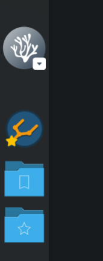
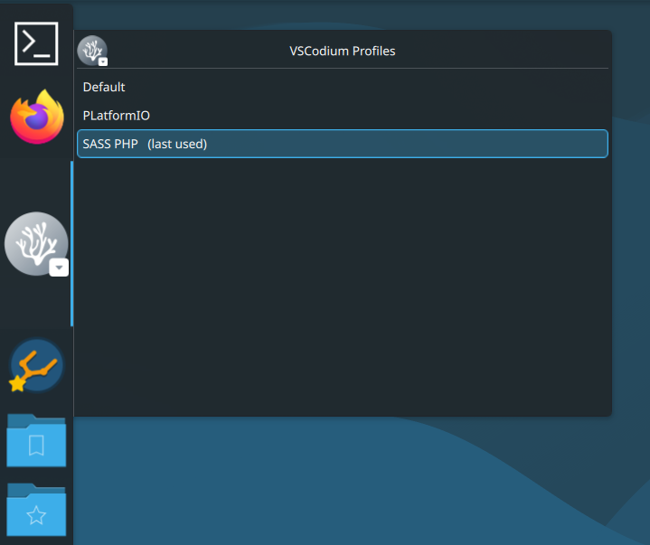
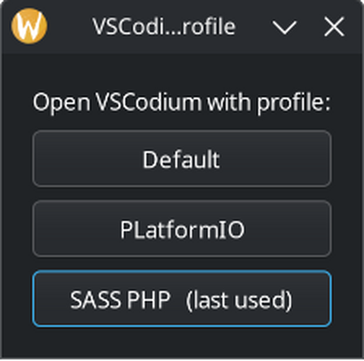
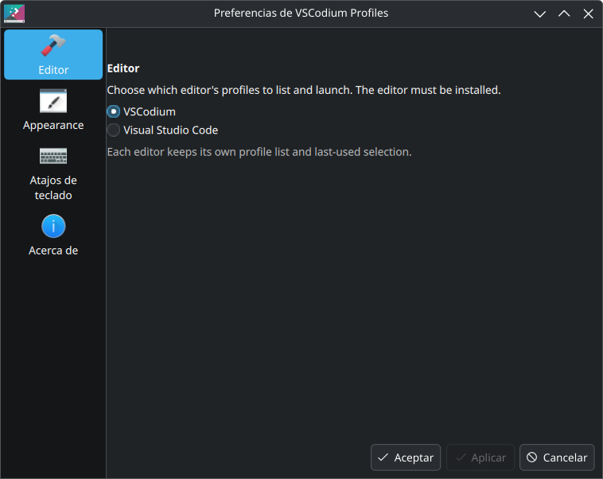
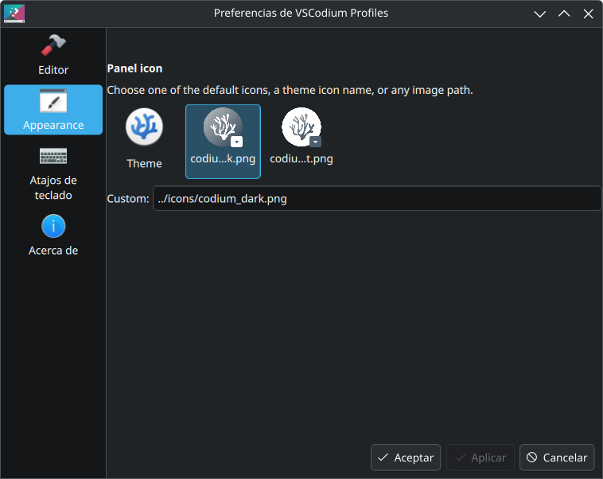

# VSCodium Profiler

A small KDE Plasma 6 workflow for choosing a VSCodium or Visual Studio Code profile before opening a window. It includes a helper script, a GTK button picker, and a Plasma panel plasmoid based on `org.kde.plasma.konsoleprofiles`.

> [!WARNING]
> **Vibe-coded disclaimer:** This project was created with AI assistance. It works on the author's machine, but expect rough edges and review the code before relying on it. It is provided "as is", without warranty of any kind. Not affiliated with VSCodium, Microsoft, or KDE.

## Features

- Discovers profiles dynamically from the editor's `storage.json`
- One-click GTK picker with a button per profile
- `kdialog` fallback when GTK 3 is unavailable
- Remembers the last used profile per editor
- Forwards file and folder arguments to the editor
- Plasma 6 panel applet with a profile popup
- Config pages for choosing VSCodium or VS Code and selecting the panel icon
- Supports theme icon names, image files, and icons detected from `icons/`

## Screenshots

Plasmoid icon in the Plasma panel:



Profile popup:



GTK picker dialog:



Editor configuration page:



Appearance configuration page:



## Requirements

- KDE Plasma 6
- `bash`
- `jq`
- `python3` with GTK 3 via `gi`, **or** `kdialog`
- `codium` and/or `code` available in `PATH`
- `kpackagetool6` for installing the plasmoid

## Installation

Clone the repository:

```bash
git clone git@github.com:d3signa/VSCodium-profiler.git
cd VSCodium-profiler
```

Run the installer:

```bash
./install.sh
```

It installs or upgrades the plasmoid, copies the helper to `~/.local/bin/vscodium-profile.sh`, and installs the desktop launcher with an `Exec=` path pointing to that copied helper.

### Manual installation

Make the helper executable:

```bash
chmod +x vscodium-profile.sh
```

Install or upgrade the plasmoid:

```bash
kpackagetool6 --type Plasma/Applet --install plasmoid/org.d3signa.vscodiumprofiles
# or, if already installed:
kpackagetool6 --type Plasma/Applet --upgrade plasmoid/org.d3signa.vscodiumprofiles
```

Install the desktop launcher manually:

```bash
cp vscodium-profile.desktop ~/.local/share/applications/
update-desktop-database ~/.local/share/applications 2>/dev/null || true
```

If you copy the launcher manually, edit its `Exec=` line to point to the installed helper, for example:

```ini
Exec=/home/you/.local/bin/vscodium-profile.sh %F
```

### Self-contained plasmoid

The plasmoid bundles its helper script and default icons inside the package, so it does not depend on where this repository is cloned.

- Bundled helper: `plasmoid/org.d3signa.vscodiumprofiles/contents/ui/vscodium-profile.sh`
- Bundled icons: `plasmoid/org.d3signa.vscodiumprofiles/contents/icons/`

The repo-root `vscodium-profile.sh` is kept for command-line use and as the source for `~/.local/bin`. If you change the helper, update both copies; they must stay identical.

Only the repository copy of `vscodium-profile.desktop` contains the original absolute `Exec=` path. `install.sh` rewrites it to use `~/.local/bin/vscodium-profile.sh` in the installed launcher.

### Uninstall

```bash
./uninstall.sh
```

This removes the plasmoid, `~/.local/bin/vscodium-profile.sh`, and `~/.local/share/applications/vscodium-profile.desktop`.

## Usage

### GUI picker

Run the script with no arguments:

```bash
./vscodium-profile.sh
```

Click a profile button to launch that profile immediately.

Forward files or folders to the editor:

```bash
./vscodium-profile.sh ~/Projects/example README.md
```

The picker opens first, then the selected editor receives the paths.

### Direct launch modes

Open a profile directly:

```bash
./vscodium-profile.sh --profile "SASS PHP"
```

Use VS Code instead of VSCodium:

```bash
./vscodium-profile.sh --editor vscode --profile "Web"
```

List profiles and show the last used profile:

```bash
./vscodium-profile.sh --list-profiles
./vscodium-profile.sh --last-profile
./vscodium-profile.sh --editor vscode --list-profiles
```

`--editor vscodium|vscode` must come before the mode argument.

### Plasmoid

1. Right-click the Plasma panel → **Add Widgets…**
2. Search for **VSCodium Profiles**
3. Add it to the panel
4. Click the icon to open the profile list
5. Select a profile to launch it

Right-click the plasmoid → **Configure…** to open the config pages:

- **Editor** — choose VSCodium or Visual Studio Code
- **Appearance** — choose a theme icon, one of the PNGs from `icons/`, or a custom icon name/path

After changing the icon, restart Plasma once if the panel icon does not refresh:

```bash
killall plasmashell; plasmashell --replace
```

## State and profile discovery

Profiles are read from:

- VSCodium: `~/.config/VSCodium/User/globalStorage/storage.json`
- VS Code: `~/.config/Code/User/globalStorage/storage.json`

Last-used profiles are stored separately:

- `~/.config/vscodium-profile/last`
- `~/.config/vscode-profile/last`

## Notes

- The script does not use `--new-window`; window reuse is left to the editor.
- VS Code support requires the `code` binary to be installed. Profile discovery still works without it, but launching will fail with a clear error.
- New PNG/SVG files added to `icons/` appear automatically in the Appearance config page.

created by d3signa.com
